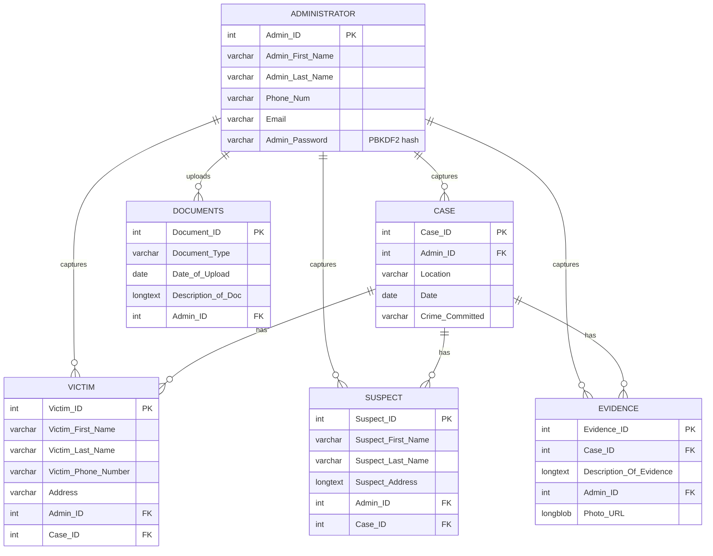

# ePolice Management System

A web-based police case management system that replaces paper dockets with a secure, searchable digital record. Administrators register and manage cases, victims, suspects, evidence and case documents, and officers get a read-only view of the same records.

Built with **ASP.NET Web Forms, C# and MySQL** as part of my BSc Information Technology studies at North-West University.

## Why this exists

Paper-based case handling leads to lost dockets, duplicated effort and slow lookups. ePolice keeps every case, and everything attached to it, in one place where it can be searched in seconds and traced back to the administrator who captured it.

## Features

- **Role-based access.** A master administrator, regular administrators, and a read-only officer view.
- **Full case lifecycle.** Register, update and delete cases, victims (complainants), suspects, evidence and case documents.
- **Evidence photos.** Upload and attach a photo to an evidence record.
- **Search across everything.** One search box filters cases, victims, suspects, evidence, documents and administrators at once.
- **Administrator management.** Only the master administrator can create, update or delete administrator accounts.
- **Accountability.** Every record stores the ID of the administrator who captured it.

## Screenshots

**Database design**


**System process model**


<!--
Add screenshots of the running application to docs/screenshots/ and uncomment:


-->

## Tech stack

| Layer | Technology |
| --- | --- |
| Front end | ASP.NET Web Forms (HTML, CSS, JavaScript) |
| Back end | C#, .NET Framework 4.7.2+ |
| Database | MySQL 8 via the `MySql.Data` connector |
| IDE | Visual Studio |

## Data model



## Getting started

### Prerequisites

- Windows with Visual Studio 2019 or later (ASP.NET workload installed)
- MySQL Server 8.x

### 1. Create the database

```sql
CREATE DATABASE mydb;
```

Then load the schema and the demo data:

```bash
mysql -u root -p mydb < Project.sql
mysql -u root -p mydb < Seed.sql
```

> Already have a database from an earlier version? Run the scripts in `Migrations/` in order instead. `001` widens the password column so hashed passwords fit (existing accounts are upgraded automatically the next time each admin logs in), and `002` stops victim records being deleted along with the administrator who captured them.

### 2. Configure the connection

Copy `ConnectionStrings.config.example` to `ConnectionStrings.config` and enter your MySQL user and password.

```xml
<add name="ePoliceDb"
     connectionString="Server=localhost;Port=3306;Database=mydb;User Id=YOUR_MYSQL_USER;Password=YOUR_MYSQL_PASSWORD;"
     providerName="MySql.Data.MySqlClient" />
```

`ConnectionStrings.config` is in `.gitignore`, so your password is never committed.

### 3. Run it

1. Open `EPOLICE.sln` in Visual Studio.
2. Restore NuGet packages (right-click the solution, then **Restore NuGet Packages**).
3. Press **F5**.

### Demo accounts

The seed data creates two fictional accounts. Change or delete them before using the system for anything real.

| Role | Admin ID | Password |
| --- | --- | --- |
| Master administrator | `0` | `Master@123` |
| Administrator | `1001` | `Admin@123` |

Choose **Officer** on the login screen for the read-only view.

## Security

- Passwords are hashed with PBKDF2 (HMAC-SHA256, 100,000 iterations, random salt per password). Plain-text passwords are never stored.
- Every database query is parameterised, so user input is never concatenated into SQL.
- The database connection string lives outside the source code and outside Git.
- Pages require a login, and only the master administrator can create, update or delete administrator accounts.
- New administrators receive a random temporary password that is shown once.
- Uploaded images are restricted to JPG, PNG and GIF, size-limited, and saved under a generated name.

## Project structure

```text
ePolice-Management-System/
├── Login.aspx / .cs          Sign-in page
├── Registration.aspx / .cs   Master-admin-only administrator creation
├── Homepage.aspx / .cs       Main application (cases, victims, suspects, evidence, documents)
├── Db.cs                     Database connection helper
├── PasswordHasher.cs         PBKDF2 password hashing
├── Project.sql               Database schema
├── Seed.sql                  Fictional demo data
├── Migrations/               SQL scripts for upgrading an existing database
├── ConnectionStrings.config.example
├── Images/  Fonts/  Music/   Static assets
└── ePolice System Documentation.docx
```

## Roadmap

- Officer accounts with badge numbers and their own passwords
- Audit log of who changed what and when
- Dashboard with case statistics by crime type and month
- Link case documents to specific cases
- Export a case file to PDF
- Responsive layout for tablets and phones

## Author

**Potso Lejapela**

Final-Year Information Technology Student, North-West University

GitHub: https://github.com/PotsoLjay
